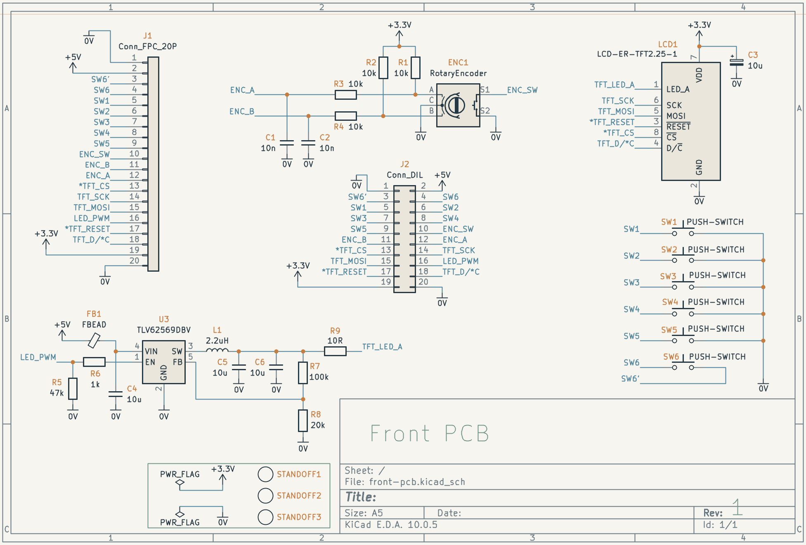

# Display\_284x76

This repository contains KiCad files for an 81 x 29 mm circuit board which contains a 284x76 pixel TFT screen, six buttons and a rotary encoder.

The interface is via either a 20-pin DIL header, or 20-way 1mm-pitch flat flex cable (FFC), to any microcontroller of choice.

The board requires a 5V supply (4.4V to 5.5V should work) at 20 mA for the backlight driver, and a 3.3V 20mA supply for the TFT driver. All signals (SPI and the PWM input) use 3.3V logic levels.

The TFT is part code ER-TFT2.25-1 from BuyDisplay. It contains a ST7789P3 display controller.

# Circuit Diagram

# Pinout

Both the 20-way DIL header and the 20-way FFC connector have the same pinout:

<!-- info: table: widths="13% 87%" -->

| Pin | Description         |
| :-- | :------------------ |
| 1   | GND                 |
| 2   | 5V Input (4.4-5.5V) |
| 3   | SW6'                |
| 4   | SW6                 |
| 5   | SW1                 |
| 6   | SW2                 |
| 7   | SW3                 |
| 8   | SW4                 |
| 9   | SW5                 |
| 10  | ENC\_SW             |
| 11  | ENC\_B              |
| 12  | ENC\_A              |
| 13  | \*TFT\_CS           |
| 14  | TFT\_SCLK           |
| 15  | TFT\_MOSI           |
| 16  | LED\_PWM            |
| 17  | \*TFT\_RESET        |
| 18  | TFT\_D/\*C          |
| 19  | 3.3V Input          |
| 20  | GND                 |

# Enclosure

A possible enclosure is Hammond 1593W. See the front-panel folder for a KiCad project for this example front panel:

M2 spacers of height 6 mm should be suitable for attaching to the display board.

# Parts List

<!-- info: table: widths="11% 10% 21% 58%" -->

| Ref     | Qty | Value          | Description                                      |
| :------ | :-- | :------------- | :----------------------------------------------- |
| C1, C2  | 2   | 10n            | Capacitor 0805                                   |
| C3      | 1   | 10u 10V        | Capacitor Tant Case B                            |
| C4-C6   | 3   | 10u 10V        | Capacitor 0805 X7R                               |
| R1-R4   | 4   | 10k            | Resistor 0805                                    |
| R5      | 1   | 47k            | Resistor 0805                                    |
| R6      | 1   | 1k             | Resistor 0805                                    |
| R7      | 1   | 100k           | Resistor 0805                                    |
| R8      | 1   | 20k            | Resistor 0805                                    |
| R9      | 1   | 10R            | Resistor 0805                                    |
| L1      | 1   | 2.2uH          | Inductor 4x4mm 2A 50 mOhm: YNR4026-2R2M          |
| U3      | 1   | TLV62569DBV    | Buck Regulator SOT-23-5                          |
| FB1     | 1   | BLM21AG121SH1D | Ferrite Bead 0805                                |
| ENC1    | 1   | ENC12E         | Rotary Encoder                                   |
| SW1-SW6 | 6   | B3F-1050       | 6x6 B3F or Kailh Mute or E-Switch 5.8x5.8 or 7x7 |
| LCD1    | 1   | ER-TFT2.25-1   | 76x284 ST7789P3 TFT LCD Screen                   |
| N/A     | 3   | M2 x 6mm       | Hex Spacer 6mm height and M2 6mm screw           |
| N/A     | 1   | Adhesive Foam  | 3.6 mm thick foam for LCD                        |

