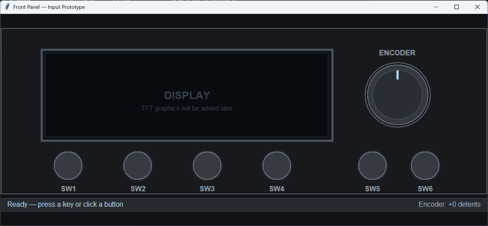

# Simulation

This folder contains mockups to experiment with.

# Skeleton Simulation

The simulation displays a mockup front panel, and the buttons can be controlled by pressing 1-4 on the keyboard to simulate the four soft-buttons.

Press 5,6 or <> or ,. or the left-right cursor keys to operate the two buttons below the rotary encoder.

Press the up-down cursor keys, or hover mouse over the rotary encoder and the use the scroll wheel to rotate it.

Run the following:

```
python ./panel_prototype.py
```




